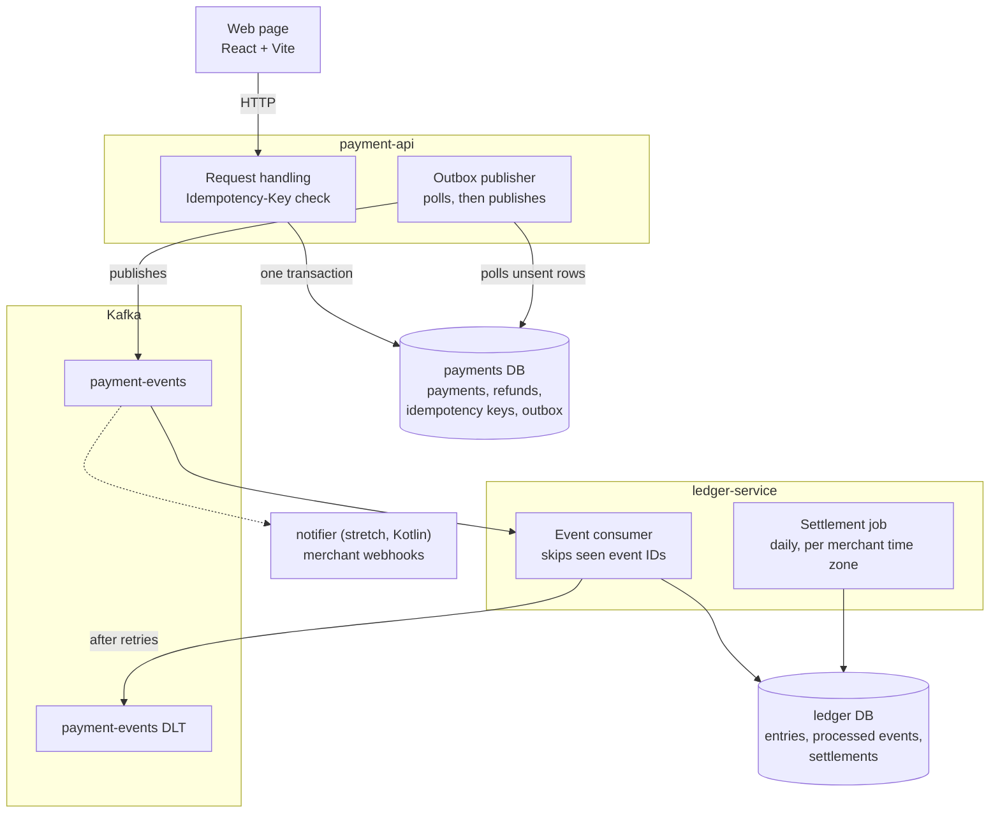

# payments-platform

A small payments platform built as separate Java 25 / Spring Boot 4.1 services that talk over Kafka. It supports idempotent payments and refunds, keeps a double-entry ledger, and computes a daily settlement per merchant that stays correct across time zones and daylight-saving changes.

> Status: **in progress** (started Nov 18, 2026). This is a learning and portfolio project, not production software.

## Services

| Service | What it does | Status |
| --- | --- | --- |
| `payment-api` | REST API: create a payment, refund all or part of it (prorated tax), look it up. Every write takes an `Idempotency-Key`. Postgres. | Weeks 1–2 |
| `ledger-service` | Consumes payment events from Kafka, writes double-entry ledger rows, skips duplicates, sends bad messages to a dead-letter topic, builds daily settlement totals per merchant. | Weeks 3–4 |
| `web` | Small React page that lists payments and triggers a refund. | Week 4 |
| `notifier` (stretch) | Webhooks to merchants, with retries and backoff, written in Kotlin. | Weeks 11–12 |

## Architecture (planned)



- **payment-api** writes the payment, its idempotency key and an outbox row in one database transaction. A separate publisher sends outbox rows to Kafka, so a Kafka outage never fails or loses a payment.
- **ledger-service** records each event ID with its ledger entries, so a redelivered event is skipped. Events that keep failing go to a dead-letter topic instead of blocking the partition.
- **Settlement** totals each merchant's day in that merchant's time zone, including 23- and 25-hour daylight-saving days.

Design decisions and their trade-offs are in [`docs/adr/`](docs/adr).

## Run locally

```bash
docker compose up -d          # Postgres (Kafka from week 3)
cd payment-api && ./mvnw spring-boot:run
```

## Roadmap

- [ ] **Weeks 1–2:** payment-api: payments, idempotency keys, full and partial refunds with prorated tax, Testcontainers tests, Dockerfile, GitHub Actions CI
- [ ] **Weeks 3–4:** Kafka, transactional outbox, ledger-service with a duplicate-safe consumer and dead-letter topic, timezone-aware settlement, React page
- [ ] **Weeks 5–6:** Kubernetes on a local kind cluster: Deployments, Services, ConfigMaps, Secrets, probes, limits, autoscaler, pod-kill recovery
- [ ] **Weeks 7–8:** Terraform on AWS (VPC, RDS, ECS Fargate behind a load balancer), CI/CD deploys, Prometheus and Grafana dashboard
- [ ] **Weeks 9–10:** k6 load test: requests per second and p95 latency, one bottleneck fixed, before and after
- [ ] **Weeks 11–12:** README polish, stretch work (Kotlin notifier, Redis for idempotency lookups)

## Results

_Load test numbers, dashboard screenshot and the deployed architecture go here in weeks 8–10._
